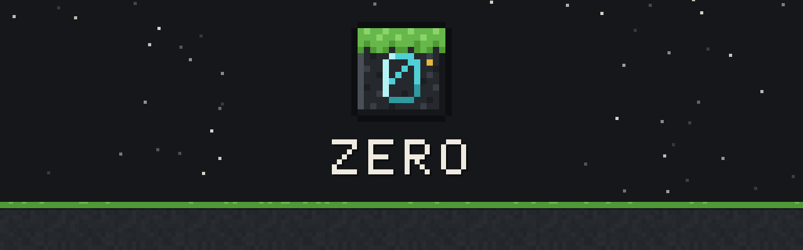
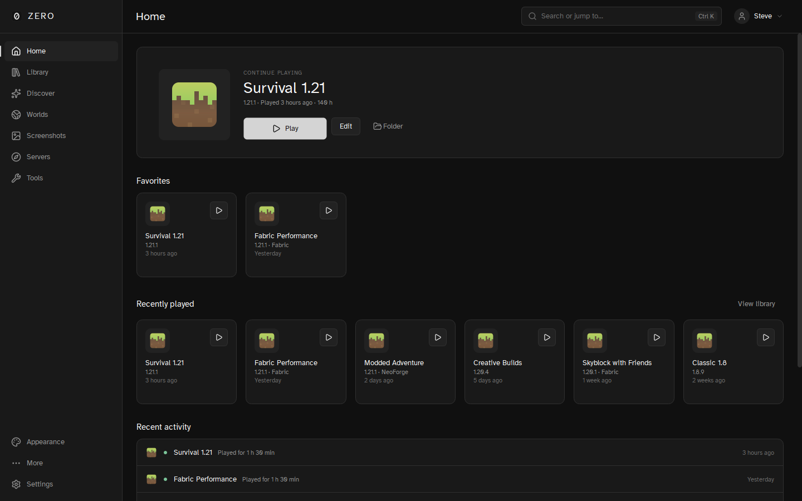
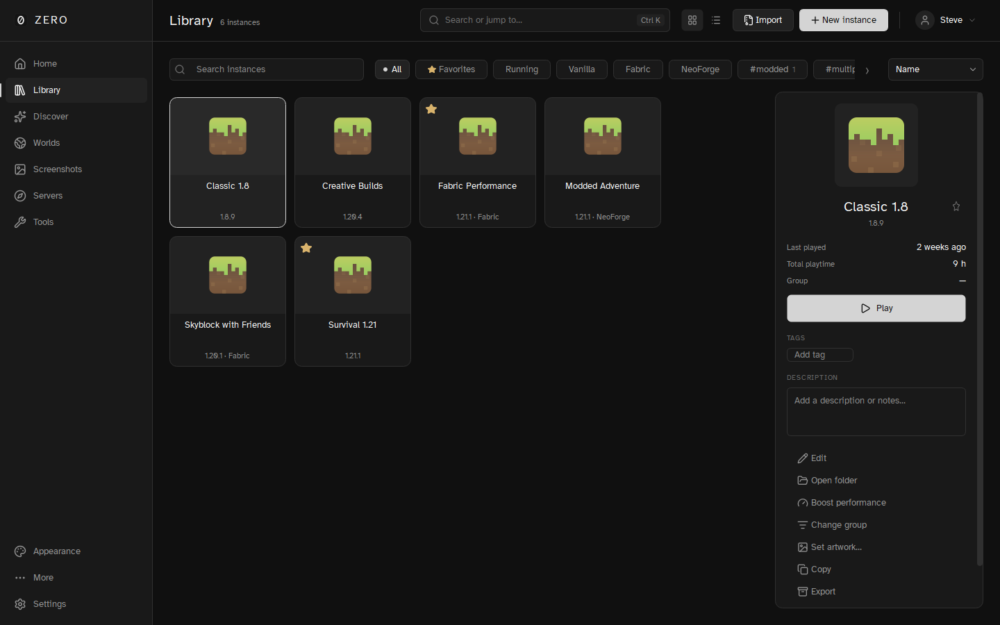
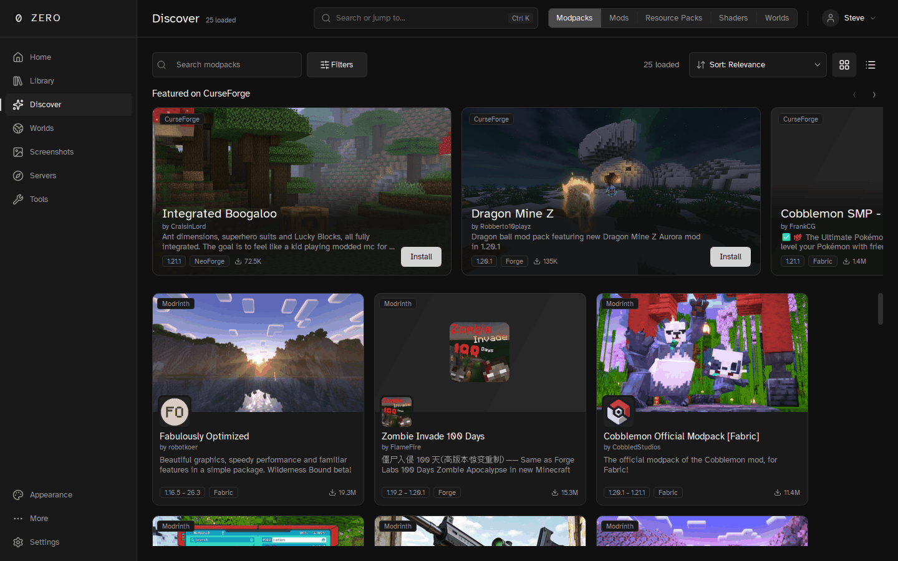
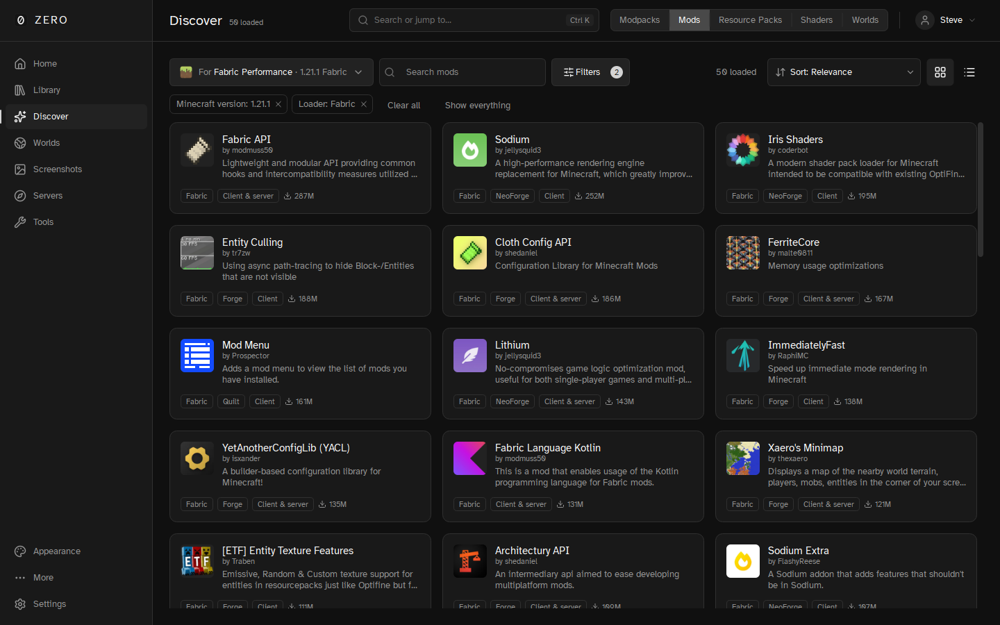
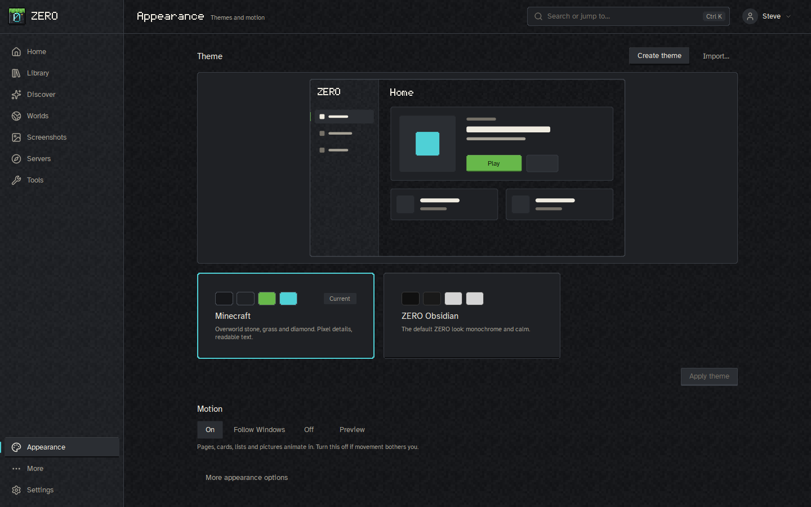
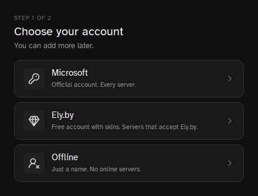
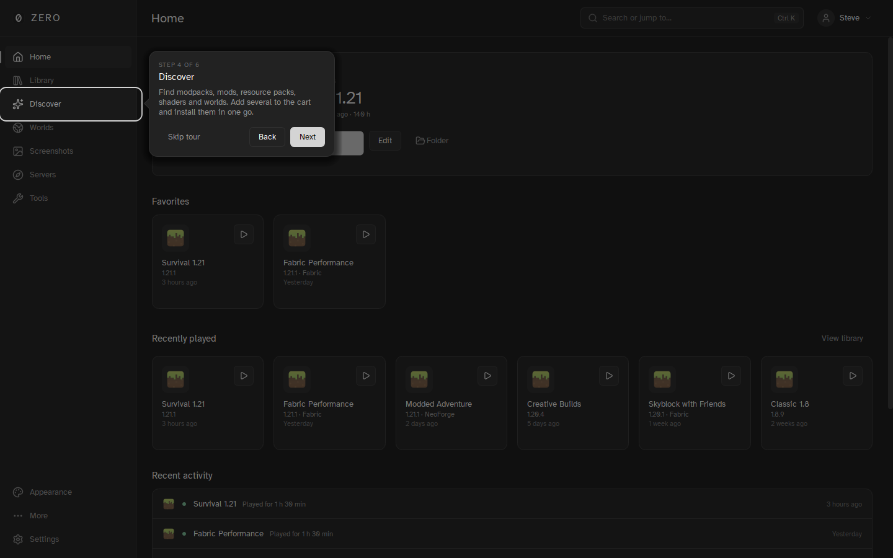
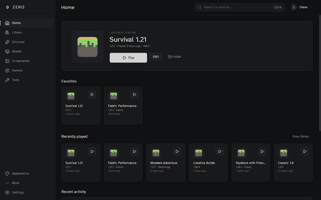
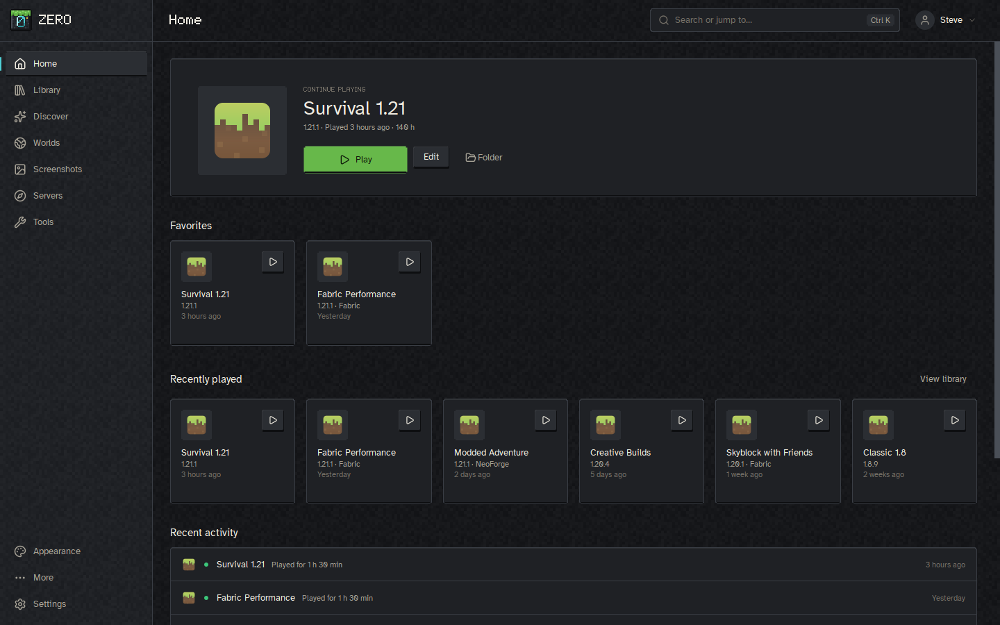

  

  <b>A fast, good-looking Minecraft launcher for Windows.</b> 
  Instances, modpacks, mods, shaders and worlds in one place, with zero friction.

  
  
  

  

## Download

1. Go to the [latest release](https://github.com/6402770-sys/ZeroCraft-Launcher/releases/latest).
2. Download **`ZEROLauncher-1.0.2-Windows-Setup.exe`** and run it. Prefer no installation? Grab the **Portable** zip instead, unzip it anywhere and open `zerolauncher.exe`.
3. The first time, ZERO greets you with a short intro, helps you sign in and shows you around.

> **"Windows protected your PC"?** ZERO is not code-signed yet, so SmartScreen asks once. Click **More info › Run anyway**. Every release lists SHA-256 checksums so you can check your download.

Coming from Prism Launcher, PolyMC or MultiMC? On first start ZERO offers to **copy** your instances and settings. Your old launcher is left untouched.

## Highlights

<table>
  <tr>
    <td width="50%" valign="top">
      
      <h3>Your library, organised</h3>
      Favourites, tags, notes, cover artwork and a "Most played" sort. Press <b>Play</b> and watch the real launch progress.
    </td>
    <td width="50%" valign="top">
      
      <h3>Discover</h3>
      Browse modpacks, mods, resource packs, shaders and worlds from <b>Modrinth</b>, <b>CurseForge</b> and <b>Technic</b> with one filter system. Put several things in the cart and install them in one go, dependencies included.
    </td>
  </tr>
  <tr>
    <td width="50%" valign="top">
      
      <h3>Mods that fit</h3>
      Pick an instance and Discover only shows what works with its Minecraft version and loader. Installed mods get update checks, and every update can be <b>rolled back</b>.
    </td>
    <td width="50%" valign="top">
      
      <h3>Make it yours</h3>
      Two built-in themes (Obsidian and Minecraft) or your own: colours, image or video background, corners, launcher icon and font. Export a theme and share it.
    </td>
  </tr>
  <tr>
    <td width="50%" valign="top">
      
      <h3>Every way to play</h3>
      Sign in with <b>Microsoft</b>, with <b>Ely.by</b> (email and password or a code, skins included) or play offline.
    </td>
    <td width="50%" valign="top">
      
      <h3>Feels at home from minute one</h3>
      A first-run intro and a quick, skippable tour. Press <b>Ctrl+K</b> anywhere to jump to an instance, a page or an action.
    </td>
  </tr>
</table>

### And also

- **Crash Detective** reads the game log after a crash and tells you what went wrong and how to fix it.
- **Worlds hub** with favourites and **Smart Backup**: automatic world backups after playing and verified restores.
- **Safe modpack updates**: ZERO saves a copy before updating and can roll the whole pack back.
- **Screenshots gallery**, **server list**, **Java Doctor**, **Storage Manager** and **performance profiles**.

  

  

## Requirements

- Windows 10 or 11, 64-bit.
- An internet connection for the first launch of each Minecraft version. ZERO downloads the right Java for you.

## Feedback

Found a bug or have an idea? [Open an issue](https://github.com/6402770-sys/ZeroCraft-Launcher/issues/new/choose). Screenshots and the game log help a lot.

## Building from source

ZERO is C++20 and Qt 6, built with CMake and Ninja on the MSYS2 UCRT64 toolchain. See [`CLAUDE.md`](CLAUDE.md) for the build commands and [`docs/zero/ARCHITECTURE.md`](docs/zero/ARCHITECTURE.md) for how it fits together. `scripts/zero/package.sh` builds the installer and the portable zip.

## Credits

ZERO Launcher is a fork of [Prism Launcher](https://github.com/PrismLauncher/PrismLauncher), which is itself a fork of MultiMC. All the instance, download and launch machinery comes from their years of work. Thank you.

**ZERO is not Prism Launcher and is not endorsed by or affiliated with the Prism Launcher project.** Please report ZERO problems here, not to Prism.

Also thanks to [Lucide](https://lucide.dev) for the icons, [Ely.by](https://ely.by) for their account service, and Modrinth, CurseForge and Technic for their APIs. Full list in [`docs/zero/THIRD_PARTY.md`](docs/zero/THIRD_PARTY.md).

## License

ZERO Launcher is free software under the [GPL-3.0-only](LICENSE) license, like Prism Launcher.

Minecraft is a trademark of Mojang AB. ZERO Launcher is not an official Minecraft product and is not approved by or associated with Mojang or Microsoft.
